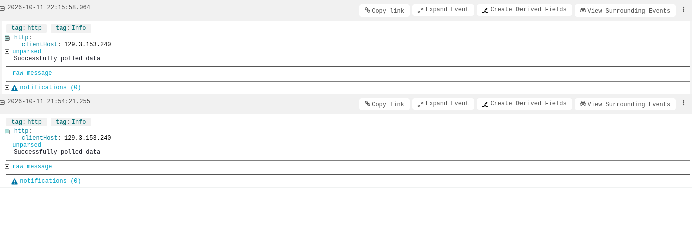

#+TITLE: Go Agent Container Build Documentation
#+AUTHOR: Max Morabito
#+latex_header: \usepackage{minted} 
#+LATEX_HEADER: \usepackage[margin=0.25in]{geometry}

* Project Location
The project's repository is located at [https://github.com/vasuki1129/csc482-project], and all code and documentation is stored there.

* Dockerfile
The Dockerfile uses an identical pipeline to the one shown in class, only specific paths have been changed to fit project structure. I won't list it here as it seems redundant.

* Build process
The output of the build process is listed here:

#+BEGIN_SRC
[max@df-port go_polling_agent]$ docker build -t go-agent:latest .
DEPRECATED: The legacy builder is deprecated and will be removed in a future release.
            Install the buildx component to build images with BuildKit:
            https://docs.docker.com/go/buildx/

Sending build context to Docker daemon  10.24kB
Step 1/11 : FROM public.ecr.aws/docker/library/golang:latest AS build
 ---> e0174e51e812
Step 2/11 : WORKDIR /build
 ---> Using cache
 ---> 3f3fd291e6eb
Step 3/11 : COPY ./source .
 ---> Using cache
 ---> 31e1bbc87054
Step 4/11 : RUN CGO_ENABLED=0 GOOS=linux go build -a -o main .
 ---> Using cache
 ---> 362f5d1c1950
Step 5/11 : FROM public.ecr.aws/docker/library/alpine:latest
 ---> 294b683cb724
Step 6/11 : RUN apk update &&     apk upgrade &&     apk add ca-certificates &&     apk add tzdata
 ---> Using cache
 ---> e86a2b22f2cf
Step 7/11 : WORKDIR /app
 ---> Using cache
 ---> 409fc253c03c
Step 8/11 : COPY --from=build /build/main ./
 ---> a5988813db15
Step 9/11 : RUN pwd && find .
 ---> Running in bfb9e4dcd9da
/app
.
./main
 ---> Removed intermediate container bfb9e4dcd9da
 ---> 905a8073e8b9
Step 10/11 : EXPOSE 8080
 ---> Running in 0442cac28b1d
 ---> Removed intermediate container 0442cac28b1d
 ---> c3497aad43c1
Step 11/11 : CMD ["./main"]
 ---> Running in 422e144a2419
 ---> Removed intermediate container 422e144a2419
 ---> db89f8803a04
Successfully built db89f8803a04
Successfully tagged go-agent:latest
#+END_SRC

\newpage

* Container Launch Process

#+BEGIN_SRC
[max@df-port go_polling_agent]$ docker run -d go-agent:latest
93441a7af2c7d887f9bf1729c4d9ca3448446b12669216e3376b4bebd0ad6fa3
#+END_SRC

We can view logs:

#+BEGIN_SRC
[max@df-port go_polling_agent]$ docker ps
CONTAINER ID   IMAGE             COMMAND    CREATED              STATUS              PORTS      NAMES
93441a7af2c7   go-agent:latest   "./main"   About a minute ago   Up About a minute   8080/tcp   great_kare
[max@df-port go_polling_agent]$ docker logs 9344
{IsBuyOrder:true LocationId:60003760 Price:7505 TypeId:30013 VolumeRemain:183 VolumeTotal:3000}
{IsBuyOrder:true LocationId:60003760 Price:7504 TypeId:30013 VolumeRemain:7308 VolumeTotal:10000}
{IsBuyOrder:true LocationId:60003760 Price:7501 TypeId:30013 VolumeRemain:76 VolumeTotal:100}
{IsBuyOrder:true LocationId:60003760 Price:7500 TypeId:30013 VolumeRemain:1058 VolumeTotal:3000}
{IsBuyOrder:true LocationId:60003760 Price:7004 TypeId:30013 VolumeRemain:20862 VolumeTotal:21000}
{IsBuyOrder:false LocationId:60003760 Price:8296 TypeId:30013 VolumeRemain:325 VolumeTotal:413}
{IsBuyOrder:false LocationId:60003760 Price:8297 TypeId:30013 VolumeRemain:2349 VolumeTotal:5000}
{IsBuyOrder:false LocationId:60003760 Price:8298 TypeId:30013 VolumeRemain:412 VolumeTotal:500}
{IsBuyOrder:false LocationId:60003760 Price:8300 TypeId:30013 VolumeRemain:23613 VolumeTotal:28972}
{IsBuyOrder:false LocationId:60003760 Price:8383 TypeId:30013 VolumeRemain:461 VolumeTotal:1000}
Polling again in 303 seconds
#+END_SRC

And the logging to Loggly is also still correct:

