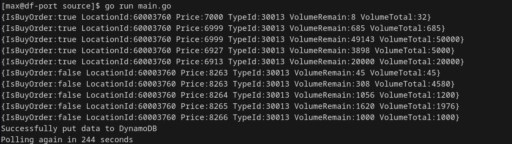
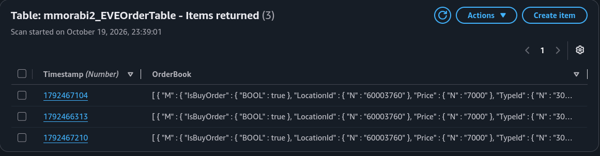
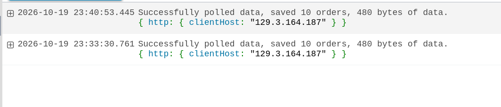

#+TITLE: DynamoDB Writes
#+AUTHOR: Max Morabito

* Project Location
The project's repository is located at [https://github.com/vasuki1129/csc482-project], and all code and documentation is stored there.

* Security Setup
The AWS credentials are pulled from environment variables, as the standard config specifies. Additionally I moved the Loggly URL to an environment variable as well, as someone could theoretically get the URL and maliciously spam it (although that would be actually just malicious, as there's no profit motive for that).

* Agent Output

* DynamoDB Documents

* Loggly Output

